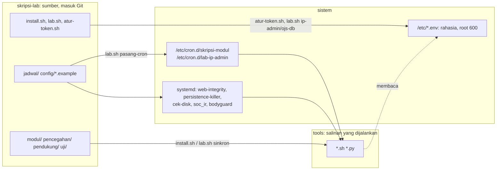
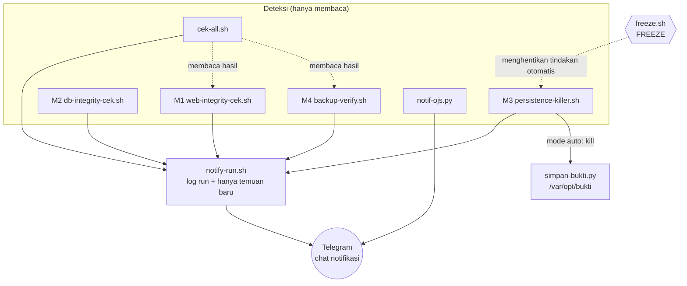
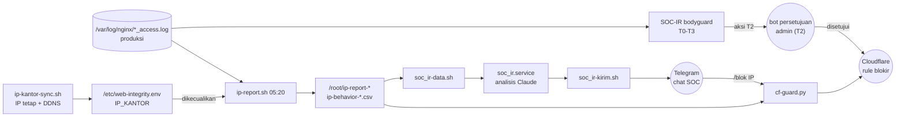
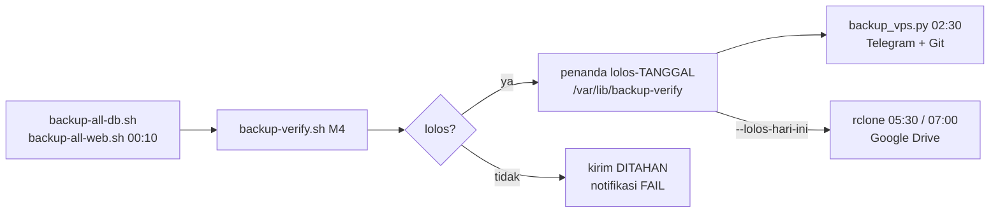
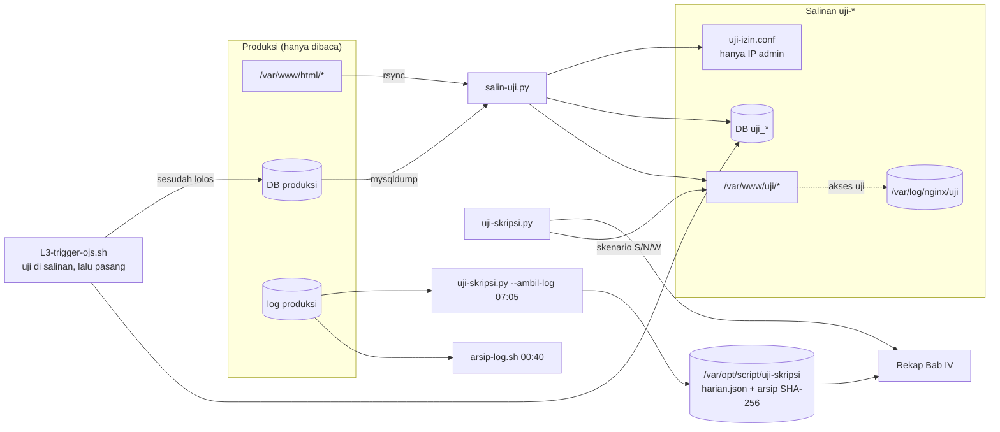

# Peta berkas dan keterkaitan

Peta ini menjelaskan berkas penting di dua folder server: folder lab (`lab-reproduksi`, atau `skripsi-lab` di
server STAI-ALI) dan folder kerja `tools`.

> [!IMPORTANT]
> **Ubah di folder lab, jalankan dari tools.** Folder lab adalah sumbernya (repo Git). Cron, systemd, dan SOC-IR
> memanggil salinan skrip di `/var/opt/script/tools/`. Setelah skrip di folder lab diganti, pasang ke tools dengan
> `lab.sh sinkron --pasang`, karena yang dijalankan selalu salinan di tools.

## Daftar isi

1. [Dua folder utama](#1-dua-folder-utama)
2. [Folder lab: skripsi-lab](#2-folder-lab-skripsi-lab)
3. [Folder kerja: tools](#3-folder-kerja-tools)
4. [Konfigurasi dan data di luar kedua folder](#4-konfigurasi-dan-data-di-luar-kedua-folder)
5. [Keterkaitan](#5-keterkaitan)

---

## 1. Dua folder utama



| Folder | Isi | Boleh diubah langsung? |
|---|---|---|
| `/var/opt/script/tools/skripsi-lab/` | Sumber lab, dokumentasi, contoh konfigurasi tanpa rahasia | Ya. Ini yang di-*push* ke GitHub |
| `/var/opt/script/tools/` | Salinan skrip yang benar-benar dijalankan | Hanya lewat pemasangan ulang dari lab |
| `/etc/…env` | Token, chat id, IP admin, nama database | Lewat `atur-token.sh`, `lab.sh ip-admin`, `lab.sh ojs-db` |

---

## 2. Folder lab: skripsi-lab

```text
skripsi-lab/
├── README.md                      panduan lengkap (pasang, urutan, jadwal, masalah umum)
├── STRUKTUR.md                    peta ini
├── PANDUAN-LAB.pdf                panduan bergambar untuk pembaca awam
├── .gitignore                     mencegah rahasia, backup, log, dan data server ikut ter-push
├── install.sh                     pemasang: paket, salin skrip ke tools, tanya IP/OJS/token
├── lab.sh                         menu: status, sinkron, ip-admin, ojs-db, demo, baseline, cek, pasang-cron, soc-ir, uji, uninstall
├── atur-token.sh                  isi/ubah token Telegram, Cloudflare, bot persetujuan (ke /etc, bukan ke lab)
├── cek-sebelum-share.sh                 periksa folder sebelum git push; mencetak file:baris saja, bukan isinya
├── lib/
│   └── umum.sh                    fungsi bersama: tanya, set_kv/get_kv (tulis env 600), status_set
│
├── modul/                         ── LIMA MODUL PENELITIAN (Bab III) ──
│   ├── M1-berkas/
│   │   ├── web-integrity-cek.sh   M1: hash berkas web vs baseline, PHP di gambar, admin/unggahan OJS, brute force
│   │   └── webscan-wp.sh          pelengkap M1: pola serangan WordPress, mingguan
│   ├── M2-database-akun/
│   │   └── db-integrity-cek.sh    M2: admin baru, akun palsu (susupan), opsi berbahaya di DB (hanya SELECT)
│   ├── M3-proses/
│   │   ├── persistence-killer.sh  M3: proses/cron/systemd tersembunyi (gsocket dsb.); dry-run / kill / auto
│   │   └── pk-systemd-setup.sh    pasang timer M3 tiap menit: dry | auto | off
│   ├── M4-backup-verify/
│   │   └── backup-verify.sh       M4: backup bisa dipakai? keutuhan, ukuran, izin 600, uji pulih, penanda lolos
│   ├── M5-blokir-attacker/
│   │   ├── ip-report.sh           M5: perilaku IP 30 hari dari log Nginx + sesi/admin OJS -> /root/ip-report-*
│   │   ├── cf-guard.py            M5: kelola rule blokir Cloudflare dari hasil ip-report; perintah bot /blok
│   │   ├── soc_ir-data.sh         salin data terbaru ke /var/lib/soc_ir/data untuk analisis soc_ir (read-only)
│   │   ├── soc_ir-kirim.sh        kirim laporan soc_ir ke chat SOC (rapi, maks 3300 byte)
│   │   └── soc-ir/bodyguard-hitl/ SOC-IR: pemindai, tingkat tindakan T0-T3, persetujuan admin (T2) lewat bot
│   └── umum/                      dipakai semua modul
│       ├── notify-run.sh          satu-satunya pengirim Telegram; log tiap run; hanya temuan baru; pesan dikelompokkan
│       ├── freeze.sh              satu tombol untuk menghentikan semua tindakan otomatis (on/off/status)
│       ├── simpan-bukti.py        simpan bukti: salinan 0400 + SHA-256 + MANIFEST.tsv
│       └── kumpulkan-bukti.sh        kumpulkan bukti insiden, termasuk temuan M1 (menyalin, tidak menghapus)
│
├── pencegahan/                    ── LAPISAN PENCEGAHAN (L3, L4), dijalankan manual ──
│   ├── L3-trigger-ojs.sh          L3: dua trigger tambahan OJS (tolak akun palsu, catat peran admin); cek/uji/pasang/batal
│   └── L4-hardening-db.sh         L4: cabut hak global akun aplikasi, kunci akun lama; cek/uji/pasang/batal
│
├── pendukung/                     ── PENDUKUNG SERVER (tidak dievaluasi sebagai modul) ──
│   ├── backup-all-db.sh           L5 tingkat 1: dump semua DB 00:10
│   ├── backup-all-web.sh          L5 tingkat 1: zip semua situs 00:10
│   ├── backup_vps.py              L5 tingkat 2: zip VPS -> Telegram + Git (hanya bila M4 lolos)
│   ├── cek-all.sh                 audit harian 06:00 + ringkasan M1-M4
│   ├── cek-disk.py                pantau disk dan umur backup (service)
│   ├── arsip-log.sh               salin log Nginx yang sudah dirotasi ke arsip bertanggal
│   ├── ip-kantor-sync.sh          IP admin = IP tetap + IP dari nama DDNS; ikut perbarui izin situs uji
│   ├── salin-uji.py               buat/tarik ulang situs salinan uji-* (cek/buat/status/hapus), log terpisah di /var/log/nginx/uji
│   ├── notif-ojs.py               notifikasi pendaftar OJS baru (L2)
│   ├── update-ip-cloudflare.sh    daftar IP Cloudflare untuk real_ip Nginx
│   ├── img-scan.sh                cari backdoor di berkas gambar (manual)
│   └── fw.sh                      aturan firewall (manual)
│
├── uji/
│   └── uji-skripsi.py             alat uji skripsi: K1-K11, 9 skenario + R1, ambil log harian, metrik, rekap Bab IV
├── jadwal/
│   ├── lab-reproduksi.cron        sumber semua baris cron
│   ├── lab-web-integrity.*        timer M1 tiap jam
│   └── lab-cek-disk.service       service cek-disk
├── config/                        contoh konfigurasi TANPA rahasia (*.example)
└── demo/
    └── demo-lab.sh                demo aman di /var/tmp/lab-demo
```

---

## 3. Folder kerja: tools

Semua skrip dari `modul/`, `pencegahan/`, `pendukung/`, dan `uji/` disalin ke satu folder ini, jadi alamatnya pendek dan tetap.

```text
/var/opt/script/tools/
├── skripsi-lab/              ← sumber (bagian 2)
│
├── notify-run.sh             dipanggil oleh hampir semua jadwal: notify-run.sh <nama-job> <perintah>
├── freeze.sh                 status / on / off
├── simpan-bukti.py, kumpulkan-bukti.sh
│
├── web-integrity-cek.sh      M1   (timer tiap jam)
├── webscan-wp.sh             M1+  (Minggu 04:00)
├── db-integrity-cek.sh       M2   (tiap jam; --full Sabtu 03:30)
├── persistence-killer.sh     M3   (timer tiap menit, sekarang dry-run)
├── pk-systemd-setup.sh
├── backup-verify.sh          M4   (sesudah backup 00:10; --restore-test Sabtu 07:45; --lolos-hari-ini untuk rclone)
├── ip-report.sh              M5   (05:20)
├── cf-guard.py               M5   (tiap 6 jam bila diaktifkan)
├── soc_ir-data.sh, soc_ir-kirim.sh   (dipakai soc_ir.service, tiap 6 jam)
│
├── L3-trigger-ojs.sh         manual
├── L4-hardening-db.sh        manual
│
├── backup-all-db.sh, backup-all-web.sh, backup_vps.py
├── cek-all.sh                (06:00)
├── cek-disk.py               (service)
├── arsip-log.sh              (00:40)
├── ip-kantor-sync.sh         (tiap 10 menit, bila ada DDNS)
├── notif-ojs.py              (tiap 5 menit)
├── salin-uji.py              manual
├── update-ip-cloudflare.sh, img-scan.sh, fw.sh
└── uji-skripsi.py            manual + --ambil-log 07:05
```

> [!NOTE]
> Di tools juga ada skrip lama milik server yang bukan bagian lab. `lab.sh uninstall` hanya menghapus skrip yang isinya
> sama persis dengan versi lab, jadi skrip lain tidak tersentuh.

---

## 4. Konfigurasi dan data di luar kedua folder

```text
/etc/
├── web-integrity.env          token+chat Telegram, IP_KANTOR(_TETAP/_DDNS), OJS_DB, ABUSEIPDB_KEY   (root 600)
├── cek-disk.env               setelan cek-disk dan backup_vps                                        (root 600)
├── bodyguard/
│   ├── cloudflare.env         token Cloudflare + CG_OFFICE_IPS untuk cf-guard                          (root 600)
│   ├── gatekeeper.env         token bot persetujuan T2 (bot terpisah)                                  (root 600)
│   └── bodyguard.conf         mode SOC-IR: dry-run / enforce
├── lab-reproduksi/status      catatan langkah lab (TELEGRAM, CLOUDFLARE, PERSETUJUAN, JADWAL)
├── cron.d/skripsi-modul       jadwal yang dipakai server ini (disusun manual dari jadwal/lab-reproduksi.cron)
├── cron.d/lab-ip-admin        sinkron IP admin tiap 10 menit (dibuat lab.sh ip-admin)
├── nginx/conf.d/uji-izin.conf IP yang boleh membuka situs uji-* (salin-uji.py, ip-kantor-sync.sh)
├── nginx/sites-available/uji-*   vhost salinan (salin-uji.py)
└── logrotate.d/nginx-uji      rotasi log salinan

/var/opt/
├── filehash-web-all/          baseline M1 (hash berkas)
├── db-integrity/              baseline M2 (*.admins, trusted_ips.txt)
├── BACKUP/{DB,web,vps}/       hasil backup tingkat 1 dan 2
├── bukti/<kasus>/             bukti insiden (simpan-bukti.py)
├── arsip-log/nginx/           arsip log Nginx (arsip-log.sh)
└── script/
    ├── known_admins.txt       admin OJS yang dikenal (M1)
    └── uji-skripsi/           data uji-skripsi.py: hasil.csv (+ hasil.versi), harian.json, baseline-arsip/ (log ber-SHA-256)

/var/lib/
├── freeze/FREEZE              kalau berkas ini ada, semua tindakan otomatis berhenti (freeze.sh)
├── backup-verify/             penanda lolos-TANGGAL dari M4
└── soc_ir/data/               salinan data untuk analisis soc_ir (read-only)

/var/log/
├── nginx/*_access.log         log situs asli: bahan ip-report, cf-guard, SOC-IR, dan rekap log harian
├── nginx/uji/                 log situs salinan (terpisah, tidak ikut dianalisis)
├── audit-run/                 log setiap run notify-run.sh
└── soc_ir/laporan-*.txt       laporan soc_ir

/root/
├── ip-report-*.txt, ip-behavior-*.csv, ip-suspects-*.txt   keluaran ip-report.sh
├── hardening-db/              cadangan grant, SQL, dan SQL pembatalan dari L4-hardening-db.sh   (700)
├── trigger-l3/                SQL pemasangan trigger L3                           (700)
└── uji-salinan/<domain>.env   kata sandi DB situs salinan                         (600)

/var/www/
├── html/<situs>/              produksi
└── uji/<domain-uji>/          salinan uji (di luar html, jadi tidak dipantau M1)
```

---

## 5. Keterkaitan

### 5.1 Alur deteksi dan notifikasi



### 5.2 Alur keputusan IP (M5)



### 5.3 Alur backup (L5 + M4)



### 5.4 Situs uji dan data penelitian



### 5.5 Siapa membaca berkas env mana

| Berkas | Ditulis oleh | Dibaca oleh |
|---|---|---|
| `/etc/web-integrity.env` | `install.sh`, `atur-token.sh`, `lab.sh ip-admin`, `lab.sh ojs-db`, `ip-kantor-sync.sh` | M1, M2, M4, `ip-report.sh`, `notify-run.sh`, `soc_ir-kirim.sh`, backup, `cek-all.sh`, `cek-disk.py`, `notif-ojs.py`, `salin-uji.py`, `L3-trigger-ojs.sh`, `uji-skripsi.py` |
| `/etc/cek-disk.env` | `atur-token.sh` | `cek-disk.py`, `backup_vps.py` |
| `/etc/bodyguard/cloudflare.env` | `atur-token.sh cloudflare`, `ip-kantor-sync.sh` (CG_OFFICE_IPS) | `cf-guard.py` |
| `/etc/bodyguard/gatekeeper.env` | `atur-token.sh` | bot persetujuan SOC-IR (T2) |
| `/etc/lab-reproduksi/status` | `lab.sh`, `atur-token.sh` | `lab.sh status` |

> [!CAUTION]
> Semua berkas di bagian 4 tetap di server dan **tidak** masuk Git. `.gitignore` dan `cek-sebelum-share.sh` menjaganya.
